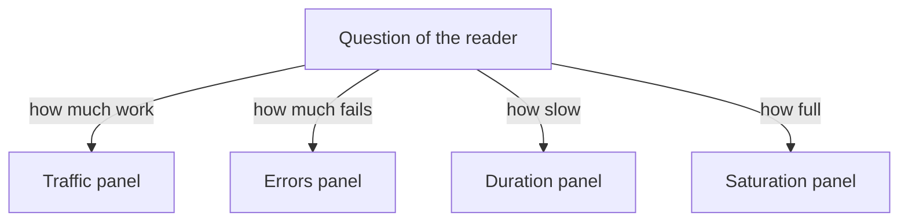

# Panels, Population And Grouping

A dashboard is a page of panels. Each panel runs one query against a data source and draws the result. A dashboard is only useful when every panel answers a question that a person has while they look at it. This page explains how to choose the panels for a service, how to decide which series each panel includes, and how grouping changes what the reader can see.

## Start with the question of the reader

Before you write a query, write down the question. "Is the service healthy right now?" needs a different panel than "Which replica causes the errors?". The first question needs a total. The second needs one line per replica.

A service overview usually answers four questions. How much work does the service receive? How much of that work fails? How long does the work take? How close is the service to a limit? These four questions are called traffic, errors, duration and saturation. Together they are known as the four golden signals.

- Traffic is a rate: requests per second.
- Errors are a rate or a ratio: failed requests per second, or the share of failed requests.
- Duration is a distribution: how long requests take, shown as a percentile such as the 95th.
- Saturation is a level: how full a constrained resource is, for example a queue.

The `probe` Deployment in the `starfleet` namespace exposes one metric for each signal. `lab_requests_total` is a counter with a `status` label. `lab_request_duration_seconds` is a histogram. `lab_queue_depth` is a gauge. A counter is a value that only increases while the process runs. A gauge is a value that can go up and down.



The diagram shows that the question comes first and each golden signal is one panel that answers it.

## Population: which series does a panel include

The population of a panel is the set of time series that the query selects. A time series is one sequence of samples that share a metric name and one set of labels. Population decides what the number means. A request rate for "all probes in all environments" is a different fact than a request rate for "the probe in `starfleet`".

You control the population with label selectors. The selector `{status="500"}` keeps only the series whose `status` label equals `500`. A selector that is too wide mixes unrelated workloads. A selector that is too narrow hides series that belong in the panel. When a replica is replaced, its `instance` label can change, and a selector written for the old value stops matching.

Prometheus adds labels to every scraped series. The `job` label names the scrape configuration. The `instance` label names the scraped address. In this environment Prometheus also adds `team="starfleet"` to the `probe` target. Selecting on these labels is how a dashboard limits itself to one team or one service.

## Grouping decides the detail

Aggregation operators such as `sum` combine many series into fewer series. The `by` clause lists the labels to keep. Every label that is not listed is removed, and series that now have identical labels are added together.

Grouping is the main choice that separates an overview from a detail view. `sum(rate(lab_requests_total[30s]))` returns one number for all requests. `sum by (status) (rate(lab_requests_total[30s]))` returns one line for each status value. A global total can hide one failing group. A line for every instance can hide a trend that all instances share. Pick the level that the question needs.

## Try it: read one metric at three levels

Select the private kubeconfig of this playground. A kubeconfig is the file that tells `kubectl` which cluster to use.

<!-- astrona:playground:renew -->

```sh
export KUBECONFIG="$(astrona kubeconfig ats-051-playground-010-01)"
test "$(kubectl config current-context)" = "kind-astro-ats-051-playground-010-01" || exit 1
```

The `shuttle` pod runs Python and can reach Prometheus. This helper function sends a PromQL query to the Prometheus HTTP API through that pod. The API returns JSON, and the helper formats it.

```sh
prom_query() {
  kubectl -n starfleet exec shuttle -- python -c "import sys,urllib.parse,urllib.request; print(urllib.request.urlopen('http://prometheus:9090/api/v1/query?'+urllib.parse.urlencode({'query':sys.argv[1]}),timeout=8).read().decode())" "$1" | python3 -m json.tool
}
```

First ask for the raw counter with no aggregation. This shows the full population: every series of the metric, with all labels.

```sh
prom_query 'lab_requests_total'
```

Look at the `metric` object of each result. The labels include `service`, `status`, `job`, `instance` and `team`. There is one series for status `200` and one for status `500`. Because the probe is the only replica, no other series appear.

Now remove every label except `status`. For the traffic panel this keeps one line for each outcome.

```sh
prom_query 'sum by (status) (rate(lab_requests_total[30s]))'
```

Each result now has only the `status` label. The value of the `200` series is about nine times the value of the `500` series, because the traffic generator makes one request in ten fail.

Last, remove all labels. This gives the single number for an overview panel.

```sh
prom_query 'sum(rate(lab_requests_total[30s]))'
```

The result has an empty `metric` object and one value. It is the sum of the two lines above. The single number answers "how much work", but it cannot show that one request in ten fails. You need the split to see that.

## Choose panels in the order the reader works

Readers scan a dashboard from the top. Put the panels that answer the broad question first, and put detail below. A good order is traffic and errors first, because they show whether users are affected. Duration follows. Saturation comes last, because it explains why the other signals change. Related panels should share the same time range and the same grouping, so the reader can compare them.

You have now seen that a panel is a query plus a choice of population and grouping. The same metric can answer different questions when you change the selector or the `by` clause. The open question is what the number means: a rate of 4 is useless until the panel states its unit and the share it belongs to.

## Common pitfalls

> [!WARNING]
> A panel without a stated population invites wrong conclusions. Do not add all series to one line just to get a clean chart: a total can hide a failing instance. Do not draw a line for every instance when the question is about the whole service. When a label value changes after a deployment, check the selector before you decide that the traffic stopped.
