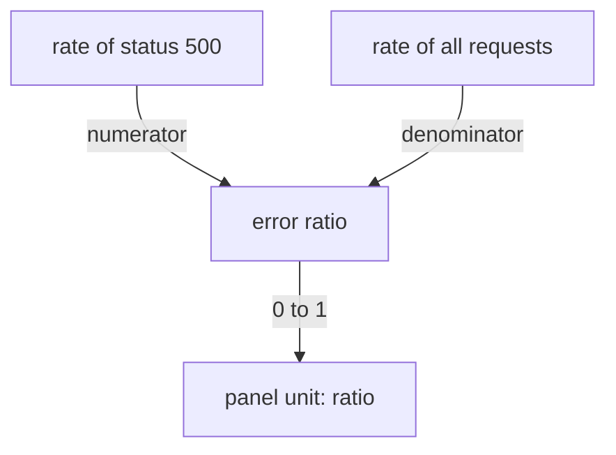

# Units, Ratios And Denominators

A number on a dashboard has no meaning until the reader knows its unit and the population it was calculated from. This page explains how counters become rates, how a ratio is built from two rates, and why a ratio needs the volume of traffic next to it. A wrong unit or a hidden denominator produces a panel that looks correct and misleads the reader.

## Counters grow, rates describe

A counter such as `lab_requests_total` only increases while the process runs. Its raw value is the number of requests since the process started. That number is rarely what a reader needs. The reader needs to know how fast requests arrive now.

The function `rate()` takes a counter and a range, for example `rate(lab_requests_total[30s])`. It calculates the average per-second increase over that range. The unit of the result is "per second". If the counter counts requests, the rate is requests per second. If the process restarts, the counter resets to zero. `rate()` detects the reset and treats the drop as a restart, so the result stays correct.

The function `increase()` returns the total increase over the range, not the per-second value. It is `rate()` multiplied by the number of seconds in the range. Use `rate()` when the panel title says "per second" and `increase()` when the panel says "in the last hour".

## Units belong in the panel

Prometheus stores plain numbers. It has no unit field. The unit comes from the metric name and from the panel. Prometheus naming conventions put the base unit in the metric name: `_seconds` for time, `_bytes` for size, `_total` for a counter. The histogram `lab_request_duration_seconds` is therefore in seconds, not milliseconds.

The dashboard tool decides how to display the number. If a panel treats a value in seconds as milliseconds, the axis is wrong by a factor of one thousand although the query is right. State the unit in the title or the axis label, and set the unit of the panel to match the unit of the metric.

## Ratios: divide two rates with the same window

An error ratio is the share of requests that fail. You calculate it as failed requests divided by all requests. Both sides must be rates over the same window, and both must describe the same population.



The diagram shows that the ratio has two inputs and that its result has no unit of its own: it is a fraction between 0 and 1.

The numerator is `sum(rate(lab_requests_total{status="500"}[30s]))`. The denominator is `sum(rate(lab_requests_total[30s]))`. Both use `sum`, so each side has no labels and the division matches the two single values. If one side kept labels that the other side lacks, the division would return nothing, because PromQL matches the left and right series by their labels.

A fraction between 0 and 1 can be shown as a percentage by setting the panel unit to percent (0.0-1.0) in the dashboard tool. The query does not change. Multiplying by 100 in the query is possible, but then the panel unit must be a plain percentage. Do one or the other, never both.

## Try it: build an error ratio

Select the private kubeconfig of this playground.

<!-- astrona:playground:renew -->

```sh
export KUBECONFIG="$(astrona kubeconfig ats-051-playground-010-01)"
test "$(kubectl config current-context)" = "kind-astro-ats-051-playground-010-01" || exit 1
```

Define the helper that sends a PromQL query to Prometheus through the `shuttle` pod.

```sh
prom_query() {
  kubectl -n starfleet exec shuttle -- python -c "import sys,urllib.parse,urllib.request; print(urllib.request.urlopen('http://prometheus:9090/api/v1/query?'+urllib.parse.urlencode({'query':sys.argv[1]}),timeout=8).read().decode())" "$1" | python3 -m json.tool
}
```

Read the raw counter first. Its value is the total number of requests since the probe started, so it is large and grows.

```sh
prom_query 'sum by (status) (lab_requests_total)'
```

Now ask for the rate. The value is now per second and stays near a constant, because the traffic generator sends requests at a steady pace.

```sh
prom_query 'sum by (status) (rate(lab_requests_total[30s]))'
```

Calculate the error ratio with the same window on both sides.

```sh
prom_query 'sum(rate(lab_requests_total{status="500"}[30s])) / sum(rate(lab_requests_total[30s]))'
```

The value is close to 0.1, because the traffic generator fails one request in ten. The result is a fraction, so a panel for this query uses the unit "ratio" or "percent (0.0-1.0)".

Finally, break the division on purpose. Keep the `status` label on the denominator only, and read the result.

```sh
prom_query 'sum(rate(lab_requests_total{status="500"}[30s])) / sum by (status) (rate(lab_requests_total[30s]))'
```

The result is empty. The left side has no labels and the right side has the label `status`, so no pair of series matches. An empty panel after a change like this is a sign of a label mismatch, not of missing traffic.

## Always show the denominator

A ratio hides the volume behind it. An error ratio of 0.1 can come from one failed request out of ten or from one million failed requests out of ten million. The risk and the action differ. When a ratio drives a decision, show the traffic panel next to it, or add the request rate to the panel as a second line.

Low traffic makes ratios jump. With one request in the window, the ratio is either 0 or 1. A reader who sees a spike to 1.0 needs the traffic panel to know that the spike was one failed request.

## Percentiles are not means

A latency panel shows a percentile or a mean, and the title must say which. The 95th percentile is the value below which 95 percent of requests fall. A mean can look fine while a small share of requests is very slow. Never put both on one axis without labelling them.

You have now seen how a counter becomes a rate, how two rates make a ratio, and why a ratio needs its volume. The next question is time: the same query can give different pictures depending on the range, the step and the window that the dashboard sends.

## Common pitfalls

> [!WARNING]
> Do not graph a raw counter and call it traffic: it only grows. Do not mix windows in a ratio, for example `[30s]` on the numerator and `[5m]` on the denominator. Do not multiply by 100 in the query and also choose a percent unit in the panel. Do not show a ratio without the request rate that supports it.
