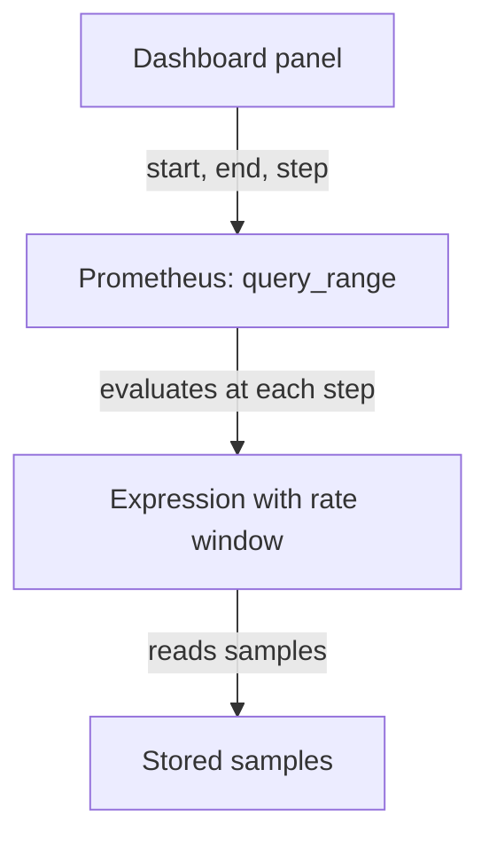

# Time Range, Step And Rate Window

A dashboard draws lines over time, so every panel sends a time range to the data source. Three separate settings shape what the reader sees: the time range, the step and the rate window. Readers often mix them up and blame the wrong one when a spike disappears or a line looks too smooth. This page explains what each setting controls and which component applies it.

## Two kinds of query

Prometheus has two query endpoints on its HTTP API. The instant query endpoint, `/api/v1/query`, evaluates an expression at one moment and returns one value for each series. The range query endpoint, `/api/v1/query_range`, evaluates the expression many times between a start time and an end time and returns a list of values for each series.

A dashboard panel that draws a line uses the range query endpoint. A panel that shows one big number uses the instant query endpoint. The range query takes three time parameters: `start`, `end` and `step`.

The `step` is the distance between two evaluation points. Prometheus evaluates the expression at `start`, at `start + step`, at `start + 2 * step` and so on until it passes `end`. The number of points in one series is therefore the length of the range divided by the step, plus one.

## The three settings

The time range is the window that the panel displays, for example the last hour. The dashboard tool turns it into `start` and `end`.

The step is the resolution of the drawn line. The dashboard tool usually chooses it from the panel width, so that there is about one point for each pixel, and the user can set a minimum.

The rate window is the range selector inside the expression, such as `[30s]` in `rate(lab_requests_total[30s])`. At every evaluation point, `rate()` looks back over that window and calculates the average per-second increase. The window belongs to the expression, not to the dashboard.



The diagram shows that the dashboard supplies the range and the step, while the rate window is part of the expression that Prometheus evaluates at each step.

## Why the settings do not replace each other

A short step cannot create data between scrapes. Prometheus scrapes the `probe` every two seconds in this environment. If a panel asks for a step of one second, Prometheus evaluates twice between two samples and returns the same value for both points. The line looks finer, but it carries no new information.

A long step skips behavior. With a step of five minutes, a failure that lasts one minute may fall between two evaluation points. The line never shows it.

A rate window shorter than twice the scrape interval is unreliable, because `rate()` needs at least two samples in the window to calculate an increase. A long window smooths the line. A spike that lasts ten seconds is averaged over a five-minute window and almost disappears, even when the step is small.

The rule is to choose a rate window of at least four scrape intervals, and a step that is not larger than the rate window. Then every sample is covered by at least one evaluation.

## Try it: count the points

Select the private kubeconfig of this playground.

<!-- astrona:playground:renew -->

```sh
export KUBECONFIG="$(astrona kubeconfig ats-051-playground-010-01)"
test "$(kubectl config current-context)" = "kind-astro-ats-051-playground-010-01" || exit 1
```

This helper sends a range query for the last 60 seconds to Prometheus through the `shuttle` pod. It takes the expression and the step in seconds. It prints how many points each returned series has.

```sh
prom_count_points() {
  kubectl -n starfleet exec shuttle -- python -c "import json,sys,time,urllib.parse,urllib.request; now=time.time(); q=urllib.parse.urlencode({'query':sys.argv[1],'start':now-60,'end':now,'step':sys.argv[2]}); body=json.load(urllib.request.urlopen('http://prometheus:9090/api/v1/query_range?'+q,timeout=8)); print([len(series['values']) for series in body['data']['result']])" "$1" "$2"
}
```

Ask for a step of 5 seconds. The range is 60 seconds, so each series has 13 points: 60 divided by 5, plus one.

```sh
prom_count_points 'sum by (status) (rate(lab_requests_total[30s]))' 5
```

The command prints one number for each series, one for status `200` and one for status `500`. Both equal 13, unless the data does not cover the whole range yet.

Now use a step of 20 seconds on the same range. The expression and the data are the same. Only the resolution changes.

```sh
prom_count_points 'sum by (status) (rate(lab_requests_total[30s]))' 20
```

Each series now has 4 points: 60 divided by 20, plus one. The line has fewer points, but it shows the same traffic.

Now compare the rate window. Read the instant value with a short window and with a long window.

```sh
prom_query() {
  kubectl -n starfleet exec shuttle -- python -c "import sys,urllib.parse,urllib.request; print(urllib.request.urlopen('http://prometheus:9090/api/v1/query?'+urllib.parse.urlencode({'query':sys.argv[1]}),timeout=8).read().decode())" "$1" | python3 -m json.tool
}
prom_query 'sum(rate(lab_requests_total[10s]))'
prom_query 'sum(rate(lab_requests_total[2m]))'
```

Both values are close to the traffic rate, because the traffic generator sends requests at a steady pace. A steady load hides the difference between the windows. With a burst of traffic, the 10 second value would react quickly and the two minute value would rise slowly.

If a window is shorter than the time the probe has been running, both queries work. Right after a restart of the environment, the two minute window can return a value that is based on fewer samples than the window allows.

## What the dashboard tool adds

Dashboard tools such as Grafana calculate the step from the panel width and the time range, and they offer a variable for the rate window that follows the step. These features choose values that satisfy the rule above. They do not change what Prometheus does: Prometheus receives `start`, `end` and `step` and evaluates the expression at those times.

You now know that the time range, the step and the rate window are three separate settings, and that the first two come from the dashboard while the third is part of the expression. The open question is what happens when no sample exists at an evaluation time, and how a panel should show that.

## Common pitfalls

> [!WARNING]
> A smaller step does not give more precise data than the scrape interval allows. A rate window shorter than two scrape intervals can return an empty result. A long rate window hides short spikes even when the panel refreshes often. Refreshing a dashboard does not create new samples: it only repeats the query.
