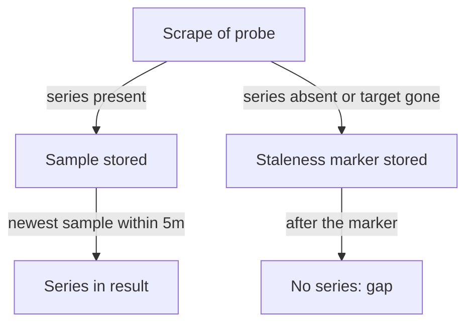

# Gaps, Staleness And Zero

A line with a hole, a line at zero and a missing line look similar on a dashboard, but they mean different things. A hole means no sample was available. A line at zero means Prometheus measured zero. A missing line means no series matched the query. Reading these three correctly decides whether an outage is noticed. This page explains how Prometheus decides that a series is missing and how to keep the three cases apart.

## How an instant value is chosen

Prometheus stores samples at the times it scraped. An expression is evaluated at a timestamp that usually falls between two samples. For a plain selector such as `lab_queue_depth`, Prometheus looks back from the evaluation time and takes the newest sample it finds within the lookback delta. The lookback delta is five minutes by default.

If the newest sample is older than the lookback delta, the series does not appear in the result at that time. The panel shows a gap.

## Staleness markers

Waiting five minutes to notice a stopped series would be slow, so Prometheus also writes staleness markers. When a scrape target disappears, or when a series is no longer present in a successful scrape, Prometheus writes a special marker value for the series. After the marker, the series no longer appears in query results, even before the lookback delta ends.



The diagram shows that a series leaves the result either when its newest sample gets older than the lookback delta or when a staleness marker follows its last sample.

This is why a series disappears from a chart soon after its target stops, and why a series with a changed label set starts a new line while the old line ends.

## Zero is a measured value

A counter that never increases has the rate zero. That is a real measurement: the process runs, Prometheus scrapes it and nothing happened. A panel that shows zero errors can be true and healthy.

A gap is different. It says that Prometheus has no sample to use. Possible causes are a failed scrape, a stopped target, a selector that no longer matches because labels changed, or a series that the application has not created yet. Many client libraries create a labelled series only when it is first used. A counter with the label `status="500"` may not exist until the first failed request. Until then, a query for it returns nothing, not zero.

## Try it: see an empty result

Select the private kubeconfig of this playground.

<!-- astrona:playground:renew -->

```sh
export KUBECONFIG="$(astrona kubeconfig ats-051-playground-010-01)"
test "$(kubectl config current-context)" = "kind-astro-ats-051-playground-010-01" || exit 1
```

Define the helper that sends a query to Prometheus through the `shuttle` pod.

```sh
prom_query() {
  kubectl -n starfleet exec shuttle -- python -c "import sys,urllib.parse,urllib.request; print(urllib.request.urlopen('http://prometheus:9090/api/v1/query?'+urllib.parse.urlencode({'query':sys.argv[1]}),timeout=8).read().decode())" "$1" | python3 -m json.tool
}
```

Query a selector that matches nothing. The probe only produces the status values `200` and `500`, so the status `404` has no series.

```sh
prom_query 'rate(lab_requests_total{status="404"}[30s])'
```

The response has `"status": "success"` and an empty `result` list. It is a valid answer and it means that no series matched. A dashboard draws an empty panel, often with the text "No data".

Now ask the opposite question with `absent()`. The function `absent()` returns one series with the value 1 when its argument returns no series, and returns nothing when the argument returns data.

```sh
prom_query 'absent(lab_requests_total{status="404"})'
prom_query 'absent(lab_requests_total{status="500"})'
```

The first query returns one series with the value 1, because no `404` series exists. The second query returns an empty result, because the `500` series exists. This is the pattern that alert rules use to detect a vanished series.

## Hiding the gap with a fallback

Many dashboards add `or vector(0)` to a query so that the panel shows zero instead of "No data". Test the effect:

```sh
prom_query 'sum(rate(lab_requests_total{status="404"}[30s])) or vector(0)'
```

The result is a single series with the value 0 and no labels. The panel now looks healthy. The risk is that the same fallback also hides a real outage. If the probe stops and its series becomes stale, a query with `or vector(0)` still draws a calm zero, and the reader cannot tell "no errors" from "no data".

Use the fallback only when a missing series truly means zero by design, for example an error counter that the application creates on its first error. Even then, put a separate panel or alert on the scrape health: the built-in metric `up` is 1 when the last scrape of a target worked and 0 when it failed.

```sh
prom_query 'up{job="probe"}'
```

The value 1 means the last scrape of the `probe` target succeeded. A dashboard that shows `up` next to the traffic panels lets the reader tell a real zero from a failed collection.

## Replaced series and duplicates

A series can disappear because its identity changed. If a pod is replaced, its `instance` label may change. The old series gets a staleness marker and a new series starts. A panel that groups by `instance` shows one line ending and another starting. Aggregating with `sum` without `instance` joins the two lines into one.

Two Prometheus servers that scrape the same target create duplicate series. A panel that sums both counts every request twice. Choose one source for a panel, or select on a label that tells the servers apart.

You have now separated three cases: a measured zero, a gap that comes from missing samples, and an empty result that comes from a selector that matches nothing. The remaining task is to combine the right query, unit and window into one panel that you can prove with evidence.

## Common pitfalls

> [!WARNING]
> Do not fill every gap with zero. A fallback of `or vector(0)` can make a collection outage look like a healthy service. A missing series is not an error in Prometheus: the query succeeds with an empty result. A selector that no longer matches after a label change looks the same as an outage. Check `up` before you decide that the application stopped.
