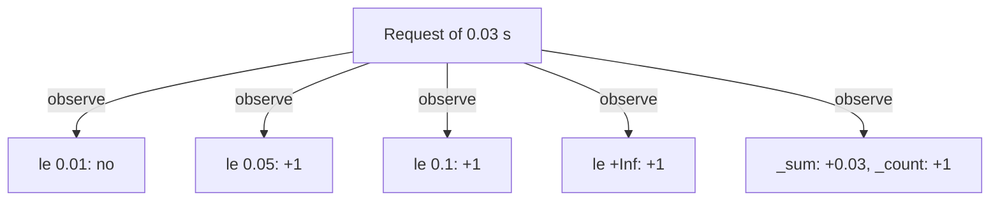

# Histograms And histogram_quantile

A latency panel must answer "how long do requests take?", but one request has one duration and a dashboard shows thousands. Prometheus stores durations in a histogram: a set of counters that count how many requests were at most a given duration. A quantile such as the 95th percentile is then estimated from those counters. This page explains how the counters are built, how the estimate is calculated and where the estimate can be wrong.

## What a histogram stores

A histogram metric is a family of three kinds of series. For the metric `lab_request_duration_seconds` they are:

- `lab_request_duration_seconds_bucket`: one counter for each bucket, with the label `le`.
- `lab_request_duration_seconds_sum`: the total of all observed durations, in seconds.
- `lab_request_duration_seconds_count`: the number of observations.

The label `le` means "less than or equal to". The bucket with `le="0.05"` counts every request that took 0.05 seconds or less. The buckets are cumulative: the `le="0.1"` bucket includes everything in the `le="0.05"` bucket and also the requests between 0.05 and 0.1 seconds. The last bucket has `le="+Inf"`. It counts all observations, so its value always equals the `_count` series.

The `probe` in this environment uses the bucket bounds 0.01, 0.05 and 0.1 seconds, plus `+Inf`. The application chooses the bounds when it is written. Prometheus does not change them.



The diagram shows that one observation increments every bucket whose bound is at least the duration, and also updates the sum and the count.

## How histogram_quantile estimates

The function `histogram_quantile(0.95, ...)` takes the buckets and finds the duration below which 95 percent of the observations fall. Prometheus does not store single durations, so it cannot know the exact value. It finds the bucket where the 95 percent mark falls and assumes that the observations inside that bucket are spread evenly. Then it interpolates linearly between the lower and the upper bound of the bucket.

Here is a worked example with invented numbers. Suppose 100 requests were observed. 60 were at most 0.05 seconds, and 90 were at most 0.1 seconds. The 95th percentile is the 95th request in order. It lies in the `+Inf` bucket, above 0.1 seconds, because only 90 requests are at most 0.1. Prometheus cannot interpolate in the `+Inf` bucket, so it returns the upper bound of the highest finite bucket: 0.1.

Now suppose 98 requests were at most 0.1. The 90th percentile lies between the buckets 0.05 and 0.1. 60 requests are in the lower bucket, so the 90th request is the 30th of the 38 requests inside the bucket. The estimate is 0.05 + (0.1 - 0.05) * 30 / 38, about 0.0895 seconds.

## Accuracy depends on the bounds

The estimate is exact only if the observations really are spread evenly inside the bucket. If all requests in the bucket between 0.05 and 0.1 took 0.051 seconds, the estimate still lies somewhere in the bucket and can be nearly twice the real value. The error can never be larger than the width of the bucket.

Two rules follow. Put a bucket bound near the value that matters, for example at the target of a latency objective. And remember that a quantile above the highest finite bound is reported as that bound, so a dashboard can never show a value larger than 0.1 seconds for the `probe`.

## Try it: read the buckets

Select the private kubeconfig of this playground.

<!-- astrona:playground:renew -->

```sh
export KUBECONFIG="$(astrona kubeconfig ats-051-playground-010-02)"
test "$(kubectl config current-context)" = "kind-astro-ats-051-playground-010-02" || exit 1
```

Define the helper that sends a query to Prometheus through the `shuttle` pod.

```sh
prom_query() {
  kubectl -n starfleet exec shuttle -- python -c "import sys,urllib.parse,urllib.request; print(urllib.request.urlopen('http://prometheus:9090/api/v1/query?'+urllib.parse.urlencode({'query':sys.argv[1]}),timeout=8).read().decode())" "$1" | python3 -m json.tool
}
```

Read the bucket counters. Each result has an `le` label, and the values grow with the bound because the buckets are cumulative.

```sh
prom_query 'lab_request_duration_seconds_bucket'
```

The durations of the `probe` are about 0.01 seconds, so most observations fall in the lowest buckets. Now read the count and the sum. The value of the `le="+Inf"` bucket above equals the count.

```sh
prom_query 'lab_request_duration_seconds_count'
prom_query 'lab_request_duration_seconds_sum'
```

Now calculate the 95th percentile from the rate of the buckets. The `rate()` turns the cumulative counters into per-second values for the last 30 seconds, so the result describes recent requests and not all requests since the start.

```sh
prom_query 'histogram_quantile(0.95, sum by (le) (rate(lab_request_duration_seconds_bucket[30s])))'
```

The value is a duration in seconds. Because the bounds are 0.01, 0.05 and 0.1, the value can only lie between 0 and 0.1. Compare it with the 50th percentile:

```sh
prom_query 'histogram_quantile(0.5, sum by (le) (rate(lab_request_duration_seconds_bucket[30s])))'
```

Both results come from the same buckets, so they stay close when almost all observations are in one bucket. The difference between them is limited by the width of the bucket that holds the observations.

## Why the cumulative form helps

Cumulative buckets make aggregation simple. Adding the bucket counters of two replicas gives the correct bucket counters of the combined traffic. A stored quantile cannot be combined like this. That difference is the reason Prometheus keeps buckets and calculates the quantile at query time.

You now know that a histogram is a set of cumulative counters with the `le` label, that `histogram_quantile` interpolates linearly inside one bucket, and that its accuracy depends on the bucket bounds. The open question is how to combine the buckets of many series before the quantile, and how to calculate an average.

## Common pitfalls

> [!WARNING]
> Do not read a quantile as an exact measurement: it is an estimate inside one bucket. Do not run `histogram_quantile` on raw bucket counters without `rate()`: the result then describes all requests since the start of the process. A quantile above the highest finite bound is reported as that bound, so a slow service can look capped. A bucket bound that does not match your latency target makes the estimate useless for that target.
