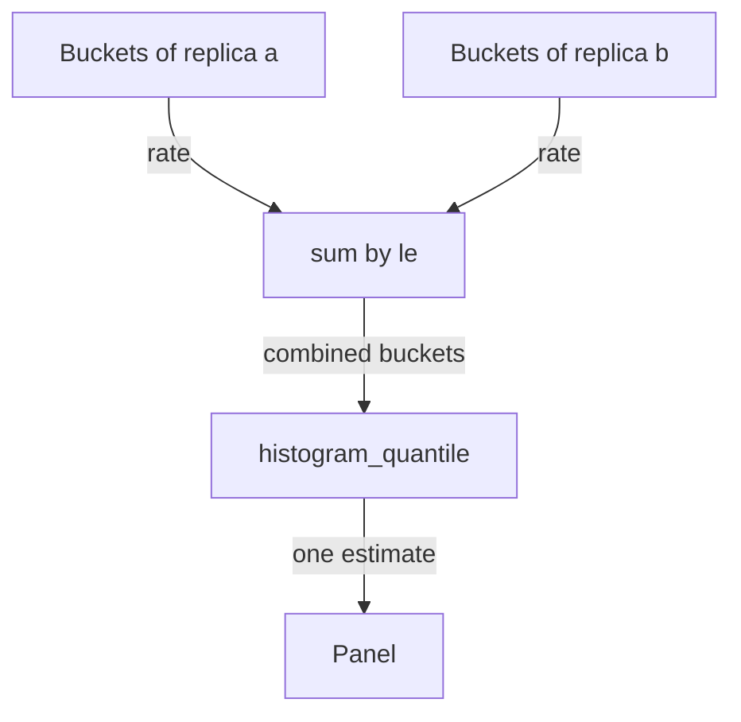

# Aggregating Quantiles And Averages

A service usually runs as many replicas, and each replica exposes its own histogram. A latency panel for the whole service must combine them. Combining is easy to do wrong, and the wrong result still looks like a valid number. This page explains the correct order of the operations, why a quantile can never be averaged and how to calculate a mean latency.

## Sum the buckets first

The correct query has this order: take the rate of the bucket counters, add the buckets of all series that belong together while keeping the `le` label, and only then calculate the quantile.

```promql
histogram_quantile(0.95, sum by (le) (rate(lab_request_duration_seconds_bucket[30s])))
```

The `sum by (le)` keeps the label `le` and removes every other label. Series from different replicas that have the same `le` are added together. The result is one set of buckets for the whole population. Then `histogram_quantile` estimates the quantile from the combined buckets, as if one process had served all requests.

To keep another label, list it next to `le`. The query `sum by (le, status)` gives one quantile for each `status` value. The `le` label must always be in the `by` clause.



The diagram shows that the replicas are combined at the bucket level and that the quantile is calculated once, on the combined buckets.

## Never average quantiles

Suppose replica a serves 1000 requests and has a 95th percentile of 0.02 seconds. Replica b serves 10 requests and has a 95th percentile of 0.1 seconds. The average of the two quantiles is 0.06 seconds. That number describes nothing: nearly all requests went to replica a, so the true quantile of the service is close to 0.02 seconds.

A quantile does not carry the number of requests behind it, and it cannot be added or averaged. The same applies to `avg`, `max` and `min` over several quantile series. The only safe way to combine is to combine the buckets and calculate the quantile once. The same rule holds for a stored percentile from a summary metric, which is explained below.

## Mean latency from sum and count

The mean latency is the total duration divided by the number of requests. The histogram stores both: the `_sum` series holds the total in seconds and the `_count` series holds the number of observations. Both are counters, so take their rates over the same window and divide.

```promql
sum(rate(lab_request_duration_seconds_sum[30s])) / sum(rate(lab_request_duration_seconds_count[30s]))
```

This works across replicas because both sides are summed before the division. The mean is exact, not an estimate. It does not depend on bucket bounds. But it hides the slow requests: a few very slow requests move the mean only a little. Show the mean next to a high quantile, and label each line.

## Summaries and histograms

Prometheus has a second metric type for latency, the summary. A summary calculates quantiles inside the application and exposes them as ready values with a `quantile` label, for example `quantile="0.95"`. A summary is accurate for one process, but you cannot aggregate its quantiles across replicas, for the reason shown above. A histogram can be aggregated, and you can choose the quantile at query time. The cost of the histogram is the limited accuracy from its bucket bounds.

A short note on versions: the buckets described here are classic histograms, where each bucket is its own series. Native histograms store the whole distribution in one series with many finer buckets. The query `histogram_quantile(0.95, sum(rate(metric[30s])))` works on a native histogram without a `by (le)`. The `probe` in this environment exposes a classic histogram.

## Try it: combine and compare

Select the private kubeconfig of this playground.

<!-- astrona:playground:renew -->

```sh
export KUBECONFIG="$(astrona kubeconfig ats-051-playground-010-02)"
test "$(kubectl config current-context)" = "kind-astro-ats-051-playground-010-02" || exit 1
```

Define the helper that sends a query to Prometheus through the `shuttle` pod.

```sh
prom_query() {
  kubectl -n starfleet exec shuttle -- python -c "import sys,urllib.parse,urllib.request; print(urllib.request.urlopen('http://prometheus:9090/api/v1/query?'+urllib.parse.urlencode({'query':sys.argv[1]}),timeout=8).read().decode())" "$1" | python3 -m json.tool
}
```

Run the correct query first. The `sum by (le)` combines all series of the histogram.

```sh
prom_query 'histogram_quantile(0.95, sum by (le) (rate(lab_request_duration_seconds_bucket[30s])))'
```

The result has one value and no labels. Now remove the `le` label on purpose by summing without a `by` clause.

```sh
prom_query 'histogram_quantile(0.95, sum(rate(lab_request_duration_seconds_bucket[30s])))'
```

The result is empty. After `sum` without `by (le)`, the series have no `le` label, and `histogram_quantile` ignores series without it. An empty panel after a change to the aggregation points to a lost `le` label.

Now calculate the mean latency from the sum and the count.

```sh
prom_query 'sum(rate(lab_request_duration_seconds_sum[30s])) / sum(rate(lab_request_duration_seconds_count[30s]))'
```

The value is the mean in seconds. The `probe` has durations of about 0.01 seconds, so the mean is close to that value. Compare it with the quantile above: both describe the same requests, but the quantile is limited to the bucket bounds and the mean is not.

## How to label the panel

A latency panel needs the metric type in its title or legend. Write "p95, estimated from buckets" and "mean, from sum and count". Set the unit of the panel to seconds, because the metric name says `_seconds`. If a reader sees 0.0895 without a unit, they cannot know whether it is seconds or a ratio.

You now know that buckets are summed with `sum by (le)` before the quantile, that quantiles are never averaged, and that the mean comes from two counter rates. The next question is how a dashboard tool automates these queries with variables and resolution settings.

## Common pitfalls

> [!WARNING]
> Do not use `avg` over quantile series. Do not drop `le` from the `by` clause. Do not calculate the quantile before the sum. Do not use different windows for `_sum` and `_count` in a mean. A mean and a quantile on one axis without labels mislead the reader, because they answer different questions.
