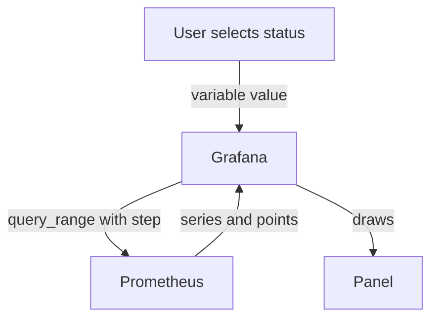

# Dashboard Variables And Query Resolution

A dashboard that is written once should work for every service, every replica and every time range. Dashboard tools solve this with variables and with automatic resolution settings. Both features end up as plain Prometheus HTTP API calls. This page explains the settings of Grafana, the dashboard tool that most Prometheus users meet, and shows the API calls that sit behind them. Grafana is not installed in the playground, so the hands-on steps use only the Prometheus HTTP API.

## How Grafana reaches Prometheus

Grafana is a web application that draws dashboards. It does not store metrics. It connects to a data source, in this case a Prometheus server, and sends it queries. A panel holds one or more queries. When a user opens the dashboard, Grafana sends each query to Prometheus and draws the answer.

For a line panel, Grafana calls the range query endpoint, `/api/v1/query_range`, with `start`, `end` and `step`. Grafana calculates the step. Two panel settings control it. The max data points setting limits how many points Grafana asks for, and by default it follows the width of the panel in pixels. The min step setting sets a lower limit for the step, and it should not be smaller than the scrape interval, because a smaller step adds no information.

Prometheus also limits one query. It rejects a range query that would return more than 11,000 points for one series.

## Variables

A variable is a named value that a user selects from a list at the top of a dashboard. A query can contain the variable, and Grafana replaces it before it sends the query. For example, a variable named `status` can hold the values of the label `status`. A panel query then uses `lab_requests_total{status="$status"}`.

The list of values often comes from Prometheus. A query variable uses the function `label_values(lab_requests_total, status)`. Grafana translates it into a call of the Prometheus HTTP API that lists the values of a label. The function `label_values(metric, label)` reads the series of the metric and returns every value that the label has.

Variables are the mechanism behind a dashboard for "all replicas" or "one replica". A variable can allow several selected values or an "All" choice. Then the panel must use a regular expression match: `status=~"$status"`. With the exact match `=`, a multi-value selection produces a broken query.

A panel can also repeat for each value of a variable. Grafana then draws one copy of the panel per selected value, each with the variable fixed to one value. Repeating is useful for a per-replica view, but it multiplies the number of queries, so use it for a limited list.



The diagram shows that Grafana substitutes the variable and calculates the step, and that Prometheus only receives a normal range query.

## The rate interval variable

A fixed rate window such as `[30s]` is wrong when the user zooms out. The step grows with the range, and a window smaller than the step leaves samples out of every evaluation. Grafana provides the variable `$__rate_interval` for this reason. It is calculated from the step and from the scrape interval that is set on the data source: at least four times the scrape interval, and at least the step plus the scrape interval. A query such as `rate(lab_requests_total[$__rate_interval])` then adapts to the zoom level.

The variable depends on the scrape interval in the data source settings. If that setting is wrong, the variable is wrong. In the playground the scrape interval is two seconds, so the examples use fixed windows.

## Try it: the API behind the variables

Select the private kubeconfig of this playground.

<!-- astrona:playground:renew -->

```sh
export KUBECONFIG="$(astrona kubeconfig ats-051-playground-010-02)"
test "$(kubectl config current-context)" = "kind-astro-ats-051-playground-010-02" || exit 1
```

This helper sends a GET request to any path of the Prometheus HTTP API through the `shuttle` pod and formats the JSON answer.

```sh
prom_get() {
  kubectl -n starfleet exec shuttle -- python -c "import sys,urllib.request; print(urllib.request.urlopen('http://prometheus:9090'+sys.argv[1],timeout=8).read().decode())" "$1" | python3 -m json.tool
}
```

The first call lists the values of the label `status`. This is what a variable with the query `label_values(status)` needs.

```sh
prom_get '/api/v1/label/status/values'
```

The result is a list of the values that exist in the data, here `200` and `500`. The second call lists the series that match a selector. A variable that depends on another variable uses this call to find the values that fit the first choice. The characters `%5B%5D` are the URL encoding of `[]` in the parameter name `match[]`.

```sh
prom_get '/api/v1/series?match%5B%5D=lab_requests_total'
```

Each entry is the full label set of one series. Now send a range query, as a panel does. The start and end values are relative, so the command computes them in the pod. The result has one list of points for each series.

```sh
kubectl -n starfleet exec shuttle -- python -c "import json,time,urllib.parse,urllib.request; now=time.time(); q=urllib.parse.urlencode({'query':'sum by (status) (rate(lab_requests_total[30s]))','start':now-120,'end':now,'step':15}); body=json.load(urllib.request.urlopen('http://prometheus:9090/api/v1/query_range?'+q,timeout=8)); print(body['status'], body['data']['resultType'], [(s['metric'], len(s['values'])) for s in body['data']['result']])"
```

The result type is `matrix`, and each series has 9 points: 120 divided by 15, plus one. This is the call that Grafana sends when the range is two minutes and the step is 15 seconds.

## How the step follows the zoom level

The step that Grafana sends is the time range divided by the max data points, rounded up to a convenient value, and never below the min step. A worked example with invented settings: the range is 6 hours, which is 21,600 seconds, and the panel allows 720 data points. The step is at least 30 seconds. If the min step is 15 seconds, the step stays at 30 seconds. The same panel with a range of 5 minutes gives 300 divided by 720, which is below 1 second, so the min step of 15 seconds applies.

This shows why the min step matters. Without it, a short range would ask for a step far below the scrape interval. Prometheus would answer, but the extra points would repeat the same samples.

The same arithmetic explains the limit of 11,000 points. A range of 7 days is 604,800 seconds. With a step of 15 seconds, the answer would have 40,321 points per series, and Prometheus would reject the query. A larger step, or a smaller range, fixes it.

## Check what the panel sends

When a panel looks wrong, check the query that reaches Prometheus. Grafana shows the final query, with all variables replaced, in the query inspector. Run that query through the API and compare. If the API answer is right and the panel is wrong, the problem lies in the panel settings: unit, legend or transformation. If the API answer is wrong, the problem lies in the query or the data.

You now know that Grafana is a client of the Prometheus HTTP API, that variables fill in label values and that the step and the rate interval follow the zoom level. The open task is to check that every panel query returns the data you expect.

## Common pitfalls

> [!WARNING]
> Use `=~` for variables that allow several values or "All". Do not set a min step below the scrape interval. Do not use a fixed rate window on a dashboard that users zoom: use `$__rate_interval` and set the scrape interval in the data source. Do not repeat a panel for a variable with hundreds of values: every copy sends its own queries to Prometheus.
