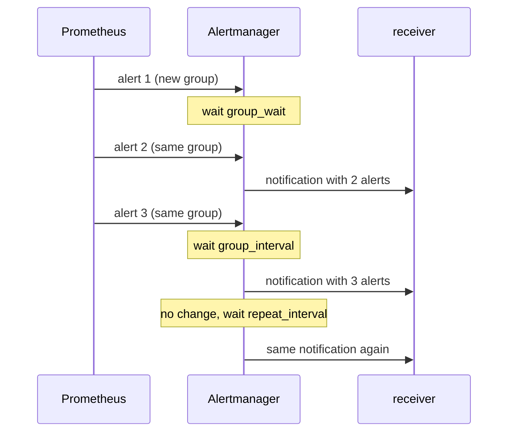

# Grouping And Notification Timing

After routing chooses a receiver, Alertmanager does not send one message per alert. It collects alerts into groups and sends one notification per group. This keeps a single outage that affects twenty replicas from producing twenty messages. Grouping and timing are the settings that decide how many notifications a person receives and how soon.

## Aggregation Groups

Each route has a `group_by` list of label names. Alertmanager builds a group key from the values of those labels on every alert that reached the route. Alerts with the same key form one aggregation group. With `group_by: [alertname, service]`, all `ProbeDown` alerts for the service `probe` form one group, no matter how many `instance` values they carry. A `ProbeDown` alert for the service `shuttle` forms a different group.

Two special forms exist. The value `group_by: ['...']` groups by all labels, which means every alert is its own group. If `group_by` is empty or unset, all alerts that reach the route fall into a single group.

A label that is not in `group_by` still appears in the notification. The notification lists every alert in the group with its full label set, and it also shows the common labels at the top. Grouping changes how alerts are combined, not which labels are sent.

## The Three Timers

Three durations control when a group sends a notification. They are set on a route and inherited by its children.

- `group_wait` is how long Alertmanager waits after the first alert of a new group arrives before it sends the first notification. During this time other alerts of the same group can arrive and join the first message. The default is 30 seconds.
- `group_interval` is how long Alertmanager waits before it sends a new notification about changes to a group that has already notified. If an alert joins the group or resolves, the next message leaves after this interval. The default is 5 minutes.
- `repeat_interval` is how long Alertmanager waits before it sends the same, unchanged group notification again. The default is 4 hours.

The timers belong to the group, not to a single alert. A group that has just sent a notification stays quiet until `group_interval` has passed, even when a new alert arrives one second later.



The diagram shows that the first message waits for `group_wait`, later changes wait for `group_interval`, and an unchanged group repeats on `repeat_interval`.

## Timers Are Not The Rule's for Duration

The `for` field in an alerting rule is evaluated by Prometheus. It holds an alert in the pending state until the condition has been true for that long, and only then does Prometheus send the alert to Alertmanager. The Alertmanager timers start after the alert has arrived. The delays add up: an alert is first sent after `for`, then waits `group_wait` before the first notification.

Changing `group_wait` therefore never makes a condition fire sooner or later, and changing `for` never changes how alerts are combined.

## Resolved Alerts

Prometheus keeps sending a firing alert to Alertmanager on every evaluation. When the condition stops being true, Prometheus sends the alert with an end time. Alertmanager marks the alert resolved. A receiver notifies about the resolution only when it has `send_resolved: true`. Webhook receivers default to `send_resolved: true`. An alert that stops arriving without an end time also expires after `resolve_timeout` in the global block.

## Choosing group_by

Pick the labels that name one incident for one team. Grouping by `alertname` alone puts all services with the same failing alert in one message. Grouping by `alertname` and `service` splits them per service, which suits teams that own one service each. Grouping by `instance` creates a message for every replica and defeats the purpose.

A route must keep the labels it groups on. If a rule drops `service` in its aggregation, all alerts get an empty value for `service` and collapse into one group.

## Testing Grouping In The Playground

The playground Alertmanager runs with `group_wait: 0s` and `group_interval: 2s`, so the effect shows within seconds. Save this as `group-check.py`:

<!-- astrona:playground:renew -->

```python
import json, subprocess, time

def in_shuttle(code):
    result = subprocess.run(['kubectl', '-n', 'starfleet', 'exec', 'shuttle', '--', 'python', '-c', code],
                            capture_output=True, text=True, timeout=30)
    return result.stdout.strip()

post = '''
import json, urllib.request
alerts = [{"labels": {"alertname": "ProbeDown", "service": "probe", "instance": name}} for name in ("a", "b")]
request = urllib.request.Request("http://alertmanager:9093/api/v2/alerts", data=json.dumps(alerts).encode(),
                                 headers={"Content-Type": "application/json"})
print(urllib.request.urlopen(request, timeout=8).status)
'''
print(in_shuttle(post))
time.sleep(8)
hooks = in_shuttle('import urllib.request; print(urllib.request.urlopen("http://probe:8080/hooks", timeout=8).read().decode())')
for body in json.loads(hooks):
    print(body.get('receiver'), [alert['labels'].get('instance') for alert in body.get('alerts', [])])
```

Run it:

```sh
python3 group-check.py
```

The route groups by `alertname`, so both instances belong to one group. Read the printed lines: if grouping works, one stored body lists instances `a` and `b` together. The exact number of stored bodies also depends on earlier submissions to the same webhook, so look for the body that holds these two alerts.

## Common pitfalls

> [!WARNING]
> Do not tune `group_wait` to delay a noisy rule. The rule's `for` field controls that. Do not set `group_by` to a label that differs per replica, and do not forget that a lower `repeat_interval` repeats unchanged notifications and increases noise.
