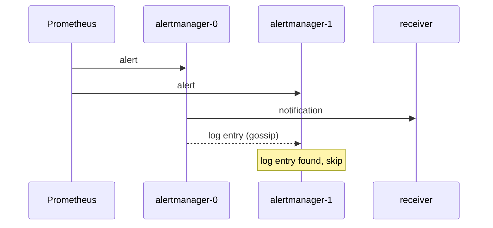

# High Availability Clustering

A single Alertmanager is a single point of failure for notifications. If it stops, firing alerts produce no messages. Running several Alertmanager instances in a cluster removes that risk. The cluster is built so that Prometheus can send every alert to every instance and the receiver still gets one notification, not one per instance.

## How Instances Find Each Other

Each instance starts with the flag `--cluster.listen-address` and a list of peers given with `--cluster.peer`. The default listen port is 9094. Instances use a gossip protocol, provided by the Memberlist library, to exchange state over this port, using both TCP and UDP. An instance that joins contacts one peer and learns about the others from it.

Setting `--cluster.listen-address=` to an empty string disables clustering. A single instance runs this way.

## What Is Shared

Two kinds of state are replicated between peers.

- Silences. A silence created on one instance is gossiped to the others, so all instances apply it.
- The notification log. When an instance sends a notification for a group, it records the group key, the receiver and the alerts it sent. Peers learn that the notification was already sent.

Alerts are not replicated. Each Prometheus sends its alerts to every Alertmanager instance directly, and each instance builds its own groups.

## How Duplicates Are Avoided

All instances receive the same alerts and compute the same groups. Each instance delays its notification by a time based on its position in the cluster. The first instance waits no extra time. The second waits one `--cluster.peer-timeout` period (15 seconds by default), the third waits twice that, and so on.

Before sending, an instance checks the notification log. If an earlier peer has already logged this notification, the later instance skips it. If the first instance has failed, the second sends after its delay. The delay is the price for high availability: a notification may arrive up to one timeout later when the first instance is down.



The diagram shows both instances receiving the alert, the first one sending the notification and the second one skipping it after the gossip arrives.

## Configuring Prometheus For A Cluster

Prometheus must list every Alertmanager instance in its `alerting` block. It sends each alert to all of them. Do not put a load balancer in front of the instances, because a load balancer would send each alert to only one instance and break deduplication. The `alerting.alertmanagers` section accepts static targets or service discovery.

```yaml
alerting:
  alertmanagers:
  - static_configs:
    - targets:
      - alertmanager-0:9093
      - alertmanager-1:9093
```

Every instance must have the same configuration file. The cluster does not distribute the configuration. Use the same ConfigMap or file for all instances. A difference in routes would give different groups on each instance and break the log matching.

## Why Each Prometheus Sends To Every Instance

Prometheus keeps no list of which Alertmanager already knows an alert. It sends the alert on every rule evaluation to every configured instance. This is deliberate. If one Alertmanager is down, the others still hold the alert and can notify. Because the same alert arrives repeatedly, Alertmanager treats it as a refresh of the alert's end time, not as a new alert, and the group does not restart its timers.

The same reasoning applies to two Prometheus servers that run identical rules for redundancy. Both send the same alerts with the same labels, and Alertmanager sees them as one alert. This works only when the label sets are identical, so any label that differs per server must be removed before sending, with `alert_relabel_configs`.

## Limits And Failure Cases

- At-least-once delivery. When a network partition splits the cluster, each side sends its own notifications, so a receiver can get duplicates. Alertmanager prefers a duplicate message to a lost one.
- Exactly-once is not promised. A crash between sending and writing the log entry can also cause a repeat.
- Persistence. State is written to the storage path of each instance. When a pod restarts without persistent storage, its silences and log are recovered from peers if any peer is running, and lost if none is.
- Gossip needs open ports. Firewalls and network policies that block port 9094 make each instance work alone and send duplicates.

## Checking Cluster State

The API path `/api/v2/status` returns a `cluster` object with the `status` (`ready` or `settling`), the instance's own `name`, and the list of `peers`. A healthy two-instance cluster lists both peers on both instances. Alertmanager also exposes metrics for the cluster, such as the number of members, which can be alerted on.

The playground runs one instance, so the status shows a cluster of a single member. The command below reads it:

<!-- astrona:playground:renew -->

```sh
kubectl -n starfleet exec shuttle -- python -c 'import urllib.request; print(urllib.request.urlopen("http://alertmanager:9093/api/v2/status", timeout=8).read().decode())'
```

In the JSON, look for the `cluster` field and its `peers` list, and for the `config` field that holds the loaded configuration text.

## Common pitfalls

> [!WARNING]
> Do not place a load balancer between Prometheus and the Alertmanager instances, and do not give instances different configuration files. A quiet notification channel does not prove the pipeline works, so alert on the Alertmanager's own failure metrics too.
